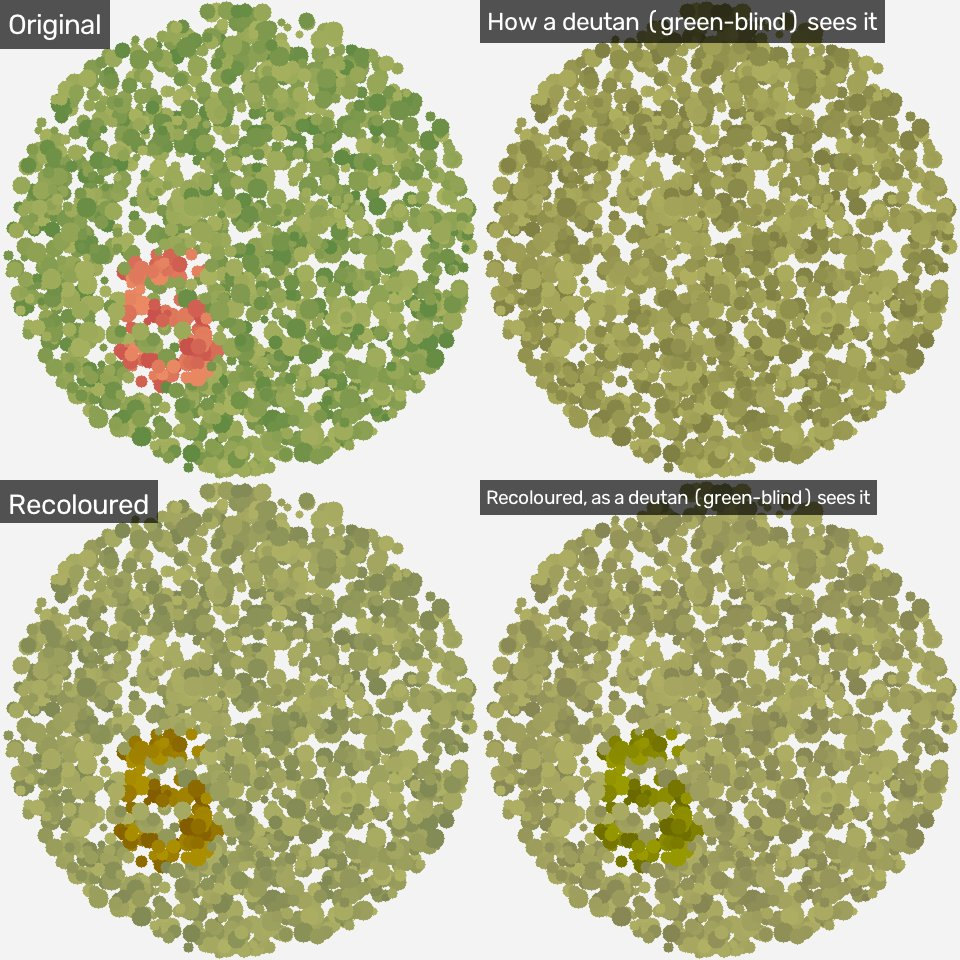

# Colour Unblind

Turn a video into colours a colour-blind person, or a cat, can tell apart.
It can also show you what the video looks like to them.

It works on video files and on your live webcam, from the command line.



*Top left: an Ishihara-style test plate. Top right: what a deutan (green-blind)
viewer sees, with the 5 gone. Bottom: the recoloured plate, and how the same
viewer sees it. The 5 is back.*

## Install

Needs Python 3.10+ and, to keep the sound in output videos, [ffmpeg](https://ffmpeg.org/download.html).

```bash
pip install .
```

## Use

```bash
# Recolour a video so a deutan (the most common type) can tell red from green
colour-unblind recolour holiday.mp4

# Pick who's watching
colour-unblind recolour holiday.mp4 --viewer protan
colour-unblind recolour holiday.mp4 --viewer cat -o for_my_cat.mp4

# Show a normal-sighted person what the video looks like to them
colour-unblind simulate holiday.mp4 --viewer tritan

# Side-by-side 2x2 grid: original, how they see it, recoloured, recoloured as they see it
colour-unblind compare holiday.mp4 --viewer achromat

# Live webcam (starts in compare mode)
colour-unblind live
```

Output goes next to the input as `NAME_MODE_VIEWER.mp4` unless you give `-o`.

**Webcam keys:** `m` next mode, `v` next viewer, `q` or `Esc` quit. If the picture doesn't
appear, try `--camera 1`; the tool waits about 3 seconds for a slow webcam to start.

### Viewers

| `--viewer` | Who | Colours they mix up |
|---|---|---|
| `deutan` (default) | Green-blind: no working M cones | Red and green |
| `protan` | Red-blind: no working L cones | Red and green; reds also look dark |
| `tritan` | Blue-blind: no working S cones | Blue and green, yellow and pink |
| `cat` | Cats | Same as a deutan (see below) |
| `achromat` | No colour vision at all | Everything; only brightness is left |

### Options

- `--severity 0..1`: how strong a protan, deutan or tritan deficiency is, for
  simulations. 1 (default) is full dichromacy; 0.5 is a milder "anomalous" form.
  Between 0.99 and 1 the model switches from Machado to Viénot, so the output
  jumps slightly there. It has no effect on cats, achromats or recolouring.
- `--strength 0..2`: how hard to push the recolouring. 1 (default) matches
  Android's built-in colour correction. 0 changes nothing. It has no effect on
  achromats or in simulate mode.

The tool prints a warning when an option you gave has no effect, and when a
damaged input file stops decoding early.
- `--blur SIGMA`: blur simulations by a Gaussian of this many pixels. Cats see
  less detail than we do (below); how many pixels that is depends on your
  screen and how far away you sit, so it's off by default.

## How it works, and where the numbers come from

Every colour transform comes from a published source. Where the tool makes its
own choice, that's said too.

**Simulation** (what they see) uses the [DaltonLens](https://daltonlens.org/opensource-cvd-simulation/)
library's implementations, picked the way DaltonLens recommends:

- Full protan/deutan: Viénot, Brettel & Mollon (1999), *Digital video colourmaps for
  checking the legibility of displays by dichromats*, Color Research & Application 24(4).
- Partial protan/deutan (`--severity` below 1): Machado, Oliveira & Fernandes (2009),
  *A physiologically-based model for simulation of color vision deficiency*, IEEE TVCG 15(6).
- Tritan: Brettel, Viénot & Mollon (1997), *Computerized simulation of color appearance
  for dichromats*, JOSA A 14(10).
- Achromat: relative luminance with the sRGB / BT.709 weights (0.2126, 0.7152, 0.0722).

The tool pulls the exact matrices out of DaltonLens once, then applies them
with fast numpy. The tests check the output matches DaltonLens to within 0.00001.

**Recolouring** for protan, deutan, tritan and cats uses the daltonizer built
into Android ([AOSP `Daltonizer.cpp`](https://android.googlesource.com/platform/frameworks/native/+/51de5c0/services/surfaceflinger/Effects/Daltonizer.cpp),
Apache-2.0). It works out the part of each colour the viewer can't see and adds
it back into colour channels they can see. Android's source says its 0.7 weights
were "chosen arbitrarily"; `--strength` scales them.

**Recolouring for achromats** can't add colour, so it turns colour differences
into brightness differences. It uses Lu, Xu & Jia (2012), *Contrast preserving
decolorization* (ICCP), through OpenCV's `cv2.decolor`. Used directly, that is
slow and ignores real brightness (every frame gets stretched to full black and
white, so night scenes turn mid-grey). So the tool:

1. runs it on a small copy of every third frame;
2. fits the same degree-2 colour polynomial OpenCV uses;
3. outputs ordinary brightness plus only the part of decolor's grey that
   brightness doesn't already explain, i.e. the colour-only contrast;
4. blends each new fit into a running average so the picture doesn't flicker.

Steps 1, 3 and 4 are the tool's own additions. Brightness stays true: dark
scenes stay dark and white stays white.

**Cats.** Clark & Clark (2016), [*Neutral point testing of color vision in the
domestic cat*](https://pubmed.ncbi.nlm.nih.gov/27720709/), Experimental Eye
Research 153:23-26, found cats are dichromats with a neutral point near 505 nm,
"nearly identical to the neutral point of the human deuteranope". Their cones
peak near 450-460 nm and 550-560 nm (same paper and its references). So the
cat viewer uses the deutan model. For detail, Caves, Brandley & Johnsen (2018),
*Visual acuity and the evolution of signals*, Trends in Ecology & Evolution
33(5), report that people resolve roughly 4 to 7 times finer detail than cats
and dogs. That's what `--blur` is for.

## Limitations

- Simulations are models of typical vision, not of any one person, and not a diagnosis.
- Real achromats (rod monochromats) see with rods, which are less sensitive to
  red than the luminance formula assumes, so reds look a bit darker to them than
  the simulation shows.
- The cat model covers colour (and optionally sharpness). It doesn't model cats'
  better night vision, wider field of view or motion sensitivity.
- Achromat recolouring is one greyscale mapping per scene, so it can't keep
  every pair of colours apart. It adapts to scene changes over a couple of
  seconds. On frames made of only a few flat colours (some slides and graphics)
  `cv2.decolor` gives no answer, so the tool keeps the last good mapping, or
  plain brightness if there is none yet.
- Output is H.264 video, tagged BT.709, with the original audio re-encoded as
  AAC, so use `.mp4`, `.mov` or `.mkv`. Odd frame sizes lose one pixel so the
  file plays everywhere. Variable-frame-rate input (common from phones and
  screen recorders) is turned into constant frame rate so the sound stays in
  sync. Without ffmpeg, output has no audio.
- The output file only appears once processing has finished successfully.

## Try it on a test plate

```bash
python examples/make_plate.py deutan plate.png
```

This makes an Ishihara-style plate whose digit only differs from the background
in colours a deutan can't see. It's for checking the tool, not a medical test.

## Development

```bash
pip install -e '.[test]'
pytest
```

## Licence

MIT. Uses DaltonLens (MIT), OpenCV (Apache-2.0) and NumPy (BSD). The recolouring
matrices are transcribed from AOSP (Apache-2.0).
